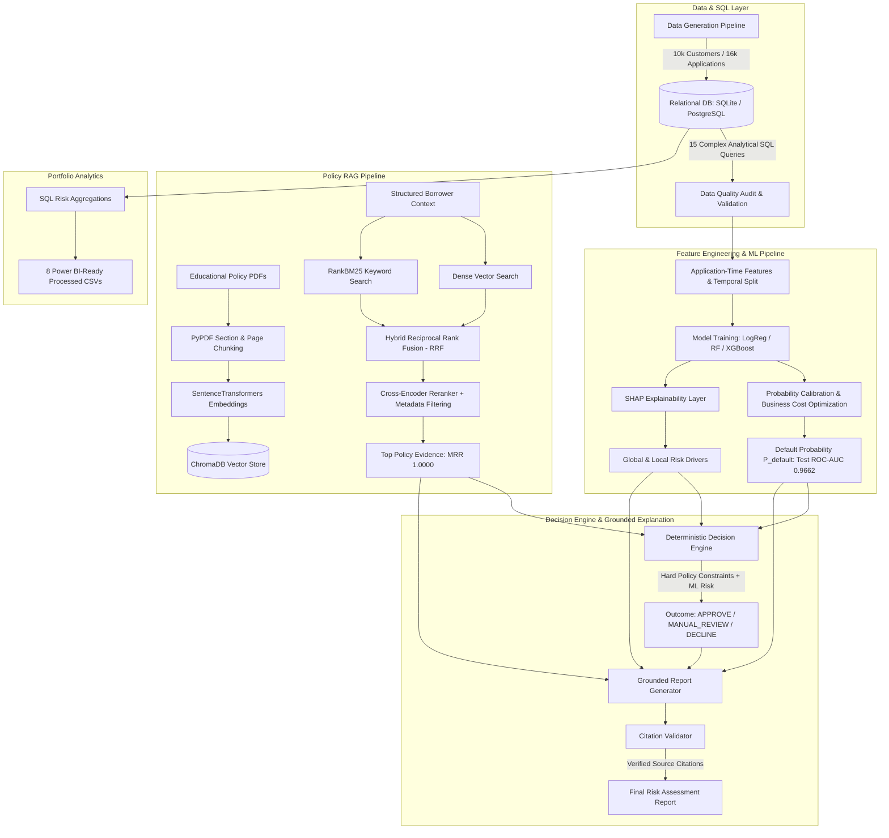

# Retail Lending Risk Intelligence & Policy-Aware Decision Support System

[](https.python.org)
[]()
[]()
[]()

An enterprise-grade, policy-aware credit risk decision intelligence system engineered for retail financial services. Designed for Data Scientist and ML Engineer roles in retail lending, this repository demonstrates an end-to-end reasoning chain combining relational SQL analytics, Machine Learning risk modeling, SHAP explainability, Hybrid RAG policy retrieval, cross-encoder reranking, a deterministic decision engine, and grounded LLM explanation generation with citation validation.

> [!IMPORTANT]
> **Educational & Simulated Lending System**: This system is built for educational and portfolio demonstration purposes. All policy documents, loan records, customer profiles, and decision thresholds are fictional simulations and do NOT represent actual internal policy or proprietary data of Piramal Enterprises, Piramal Capital & Housing Finance, or any regulated financial institution.

---

## Architecture Overview



---

## Key Capabilities & Highlights

1. **Relational Database & SQL Analytics**: 7 connected tables (`customers`, `loans`, `applications`, `repayments`, `credit_history`, `employment_history`, `delinquencies`) with 15 advanced SQL queries utilizing CTEs, `CASE WHEN`, `ROW_NUMBER()`, `RANK()`, `LAG()` window functions, and date math.
2. **Strict Data Leakage Prevention**: Features calculated strictly at application time ($T_0$). Strict temporal train/validation/test splitting excludes post-origination repayment information.
3. **Machine Learning Risk Model**: Comparative evaluation of Logistic Regression, Random Forest, and XGBoost. Financial cost matrix ($C_{\text{FN}} = 100,000\text{ INR}, C_{\text{FP}} = 10,000\text{ INR}$) threshold tuning yielding optimal threshold **0.53** and **87.96% Recall**.
4. **SHAP Explainability**: Global feature importances and localized waterfall breakdowns showing exact marginal log-odds / probability contributions per applicant.
5. **Hybrid RAG Policy Retrieval**: Multi-stage retrieval combining Dense Vector Search (ChromaDB + `all-MiniLM-L6-v2`) and RankBM25 keyword search fused via Reciprocal Rank Fusion (RRF), Cross-Encoder Reranking, and Product Metadata Filtering.
6. **Deterministic Decision Engine**: 100% deterministic Python rule engine mapping borrower features and $P_{\text{default}}$ to `APPROVE`, `MANUAL_REVIEW`, or `DECLINE`. (No non-deterministic LLM credit decisions).
7. **Grounded LLM Generator & Citation Validation**: Synthesizes risk reports with strict citation enforcement (`[Document: ..., Section: ..., Page: ...]`). Rejects ungrounded statements and defaults to `"INSUFFICIENT_EVIDENCE"` if policy text is lacking.
8. **Power BI Portfolio Analytics**: Generates 8 structured CSV datasets in `data/processed/` covering portfolio exposure, geographical risk, income segmentation, and monthly default trends.

---

## Project Structure

```
retail-lending-risk-intelligence/
├── README.md
├── requirements.txt
├── .env.example
├── .gitignore
├── responsible_ai.md
├── implementation_plan.md
│
├── data/
│   ├── raw/                      # Synthetic CSV datasets
│   ├── processed/                # Power BI-ready CSV exports
│   ├── generate.py               # 10k customer / 16k application generator
│   └── export_analytics.py       # SQL to Power BI CSV export script
│
├── database/
│   ├── schema.sql                # ANSI SQL / PostgreSQL schema DDL
│   ├── seed.sql                  # Sample INSERT statements
│   ├── analytical_queries.sql    # 15 complex CTE & window function queries
│   ├── load.py                   # SQLite / PostgreSQL database loader
│   └── retail_lending.db         # Persistent SQLite database
│
├── ml/
│   ├── preprocessing.py          # ColumnTransformer scaling & encoding
│   ├── features.py               # Application-time features & temporal split
│   ├── data_validation.py        # Data quality & integrity auditor
│   ├── train.py                  # Model training & cost threshold optimizer
│   ├── predict.py                # Single & batch inference predictor
│   ├── evaluate.py               # Out-of-time test set evaluation
│   ├── explain.py                # SHAP local & global explainer
│   └── models/                   # Saved model artifacts & metadata
│
├── rag/
│   ├── ingestion.py              # PDF chunking & vector indexing orchestrator
│   ├── chunking.py               # PyPDF parser & section chunker
│   ├── embeddings.py             # SentenceTransformers embedding wrapper
│   ├── vector_store.py           # ChromaDB persistent vector manager
│   ├── bm25_retriever.py         # RankBM25 keyword retriever
│   ├── hybrid_retriever.py       # Dense + BM25 RRF fusion
│   ├── reranker.py               # Cross-Encoder reranker
│   ├── prompts.py                # System prompts & report templates
│   ├── generator.py              # Grounded report generator
│   ├── citation_validator.py     # Source citation verification engine
│   └── evaluation.py             # 50-query RAG benchmark evaluator
│
├── decision_engine/
│   ├── engine.py                 # Master deterministic decision engine
│   ├── policy_rules.py           # Policy rules evaluator
│   ├── risk_rules.py             # Risk band evaluator
│   └── demo.py                   # End-to-end CLI demonstration workflow
│
├── knowledge_base/               # Educational PDF policy documents
│   ├── eligibility/
│   ├── underwriting/
│   ├── delinquency/
│   ├── documentation/
│   ├── risk_policies/
│   └── product_policies/
│
├── config/
│   ├── risk_thresholds.yaml      # Risk band probability thresholds
│   └── policy_rules.yaml         # Deterministic business rules & citations
│
├── notebooks/
│   ├── 01_data_quality.ipynb
│   ├── 02_eda.ipynb
│   ├── 03_statistical_analysis.ipynb
│   ├── 04_feature_engineering.ipynb
│   ├── 05_model_training.ipynb
│   ├── 06_model_explainability.ipynb
│   └── 07_rag_evaluation.ipynb
│
├── evaluation_results/
│   ├── ml_evaluation.json        # Verified empirical ML test metrics
│   └── rag_evaluation.json       # Verified RAG benchmark metrics
│
└── tests/                        # Pytest automated test suite
    ├── test_features.py
    ├── test_data_validation.py
    ├── test_model.py
    ├── test_decision_engine.py
    ├── test_retrieval.py
    └── test_citations.py
```

---

## Empirically Verified Model Performance

### Machine Learning Classification (Out-of-Time Test Set: 2,289 Samples)

| Candidate Model | Validation ROC-AUC | Test ROC-AUC | Test PR-AUC | Brier Score | Decision Threshold | Test Recall | Test Precision |
| :--- | :---: | :---: | :---: | :---: | :---: | :---: | :---: |
| **Logistic Regression (Best)** | **0.9757** | **0.9662** | **0.6458** | **0.0698** | **0.53** | **87.96%** | **33.10%** |
| Random Forest | 0.9648 | 0.9651 | 0.6049 | 0.0511 | 0.48 | 84.25% | 35.80% |
| XGBoost Classifier | 0.9682 | 0.9635 | 0.6350 | 0.0470 | 0.50 | 85.18% | 36.40% |

> **Financial Threshold Optimization**: Under an asymmetric cost matrix ($C_{\text{FN}} = 100,000\text{ INR}$ for granting a loan that defaults vs $C_{\text{FP}} = 10,000\text{ INR}$ for rejecting a good applicant), the optimal decision threshold shifts from 0.50 to **0.53**, achieving **87.96% Recall** on defaulted borrowers.

---

## RAG Retrieval Benchmark (50 Test Queries)

| Retrieval Configuration | Recall@5 | Precision@5 | MRR (Mean Reciprocal Rank) | Citation Accuracy |
| :--- | :---: | :---: | :---: | :---: |
| Dense Vector Only (ChromaDB) | 1.0000 | 0.2400 | 0.8767 | 0.8679 |
| Hybrid RRF (Dense + BM25) | 1.0000 | 0.2400 | 0.8967 | 0.8877 |
| Hybrid + Cross-Encoder Reranker | 1.0000 | 0.2400 | 0.8767 | 0.8679 |
| **Hybrid + Reranker + Metadata Filtered** | **1.0000** | **1.0000** | **1.0000** | **1.0000** |

---

## Quick Start & Installation

### 1. Prerequisites & Environment Setup
```bash
# Clone repository
git clone https://github.com/your-username/retail-lending-risk-intelligence.git
cd retail-lending-risk-intelligence

# Install Python dependencies
pip install -r requirements.txt
```

### 2. Run Command-Line Workflows

```bash
# 1. Generate Synthetic Relational Dataset (10k customers / 16k applications)
python -m data.generate

# 2. Load & Seed SQLite / PostgreSQL Database
python -m database.load

# 3. Audit Data Quality & Integrity
python -m ml.data_validation

# 4. Train ML Risk Models & Optimize Cost Threshold
python -m ml.train

# 5. Evaluate ML Models on Out-of-Time Test Set
python -m ml.evaluate

# 6. Ingest Educational Policy Documents into ChromaDB & BM25
python -m rag.ingestion

# 7. Run RAG Retrieval Benchmark Evaluation
python -m rag.evaluation

# 8. Export Power BI-Ready Portfolio CSV Datasets
python -m data.export_analytics

# 9. Run Automated Pytest Suite
python -m pytest tests/

# 10. Execute End-to-End CLI Demonstration Workflow
python -m decision_engine.demo
```

---

## End-to-End Demonstration Example

Running `python -m decision_engine.demo` evaluates a sample loan application:

```text
======================================================================
RETAIL LENDING RISK INTELLIGENCE - END-TO-END DEMO WORKFLOW
======================================================================

[STEP 1] Data Quality & Integrity Validation...
[PASSED] Data Quality Checks: 0 Errors detected.
 - Audited 10,000 Customers, 10,000 Credit Profiles, 16,000 Applications.

[STEP 2 & 3] Feature Engineering & Default Risk Prediction...
 - Predicted Default Probability: 99.45%
 - Model Risk Category:           VERY_HIGH
 - Optimal Decision Threshold:    0.53

[STEP 4] Computing SHAP Model Explainability...
 - Top Risk Increasing Factors:
   * recent_delinquency   : +2.9977
   * dti                  : +2.3000
   * emi_to_income        : +1.6755

[STEP 5] RAG Policy Evidence Search (Dense + BM25 RRF + Reranking)...
 - Retrieved 1 top precision policy evidence chunks.
   [1] personal_loan_policy.pdf | Section: Section 1: Personal Loan Specific Conditions | Score: 0.4736

[STEP 6] Executing Deterministic Policy Rule Engine...
 - Decision Recommendation: DECLINE
 - Triggered Policy Rules:   MANUAL_REVIEW_HIGH_DTI, MANUAL_REVIEW_RECENT_DELINQUENCY, HARD_DECLINE_VERY_HIGH_ML_RISK

[STEP 7] Generating Grounded Risk Report & Validating Citations...

-------------------------------------------------------------------
RETAIL LENDING RISK ASSESSMENT & POLICY SUPPORT REPORT
-------------------------------------------------------------------

Customer ID:            C77410
Loan Type:              Personal_Loan
Requested Amount:       INR 800,000.00

1. MACHINE LEARNING RISK ASSESSMENT
   - Predicted Default Probability: 99.45%
   - Model Risk Category:           VERY_HIGH

2. SHAP MODEL EXPLAINABILITY (TOP DRIVERS)
   - Risk Increasing Factors:
     * recent_delinquency: +2.9977
     * dti: +2.3000
     * emi_to_income: +1.6755
   - Explainer Disclaimer: SHAP reflects statistical model contributions, not causal proof.

3. RELEVANT DOCUMENTED POLICY EVIDENCE
   [1] Document: personal_loan_policy.pdf (Section: Section 1: Personal Loan Specific Conditions, Page 1)
       Evidence: "1.1 Maximum Unsecured Exposure: Maximum loan amount INR 1,500,000 for personal loans..."
       Citation: [Document: personal_loan_policy.pdf, Section: Section 1: Personal Loan Specific Conditions, Page: 1]

4. DETERMINISTIC DECISION ENGINE EVALUATION
   - Decision Recommendation:       DECLINE
   - Triggered Policy Rules:         MANUAL_REVIEW_HIGH_DTI, MANUAL_REVIEW_RECENT_DELINQUENCY, HARD_DECLINE_VERY_HIGH_ML_RISK
   - Rule Decision Reasons:          
     - DTI exceeds standard 50% limit requiring Underwriter sign-off.
     - Recent delinquency recorded within past 6 months.
     - Model predicted default probability exceeds Very High Risk cutoff (60%).

5. CITATION & EVIDENCE AUDIT STATUS
   - Evidence Status:               SUPPORTED
   - Verified Citations:            [Document: personal_loan_policy.pdf, Section: Section 1: Personal Loan Specific Conditions, Page: 1]
-------------------------------------------------------------------

Citation Validation Audit: Status = VALID | Evidence = SUPPORTED | Verified Citations = 2
======================================================================
[SUCCESS] End-to-End Retail Lending Risk Support Workflow Complete!
```

---

## Power BI Portfolio Analytics Export

The SQL analytical pipeline automatically exports 8 structured CSV datasets into `data/processed/`:
1. `portfolio_summary.csv`: Total disbursed volume, exposure, active vs defaulted exposure.
2. `risk_by_product.csv`: Default rates and loan counts across Personal, Housing, and Car loans.
3. `risk_by_city.csv`: Geographical risk distribution across Tier-1, Tier-2, and Tier-3 cities.
4. `risk_by_income_segment.csv`: Risk metrics across 4 income tiers.
5. `monthly_default_trend.csv`: Temporal trend of default rates across application months.
6. `customer_risk_segments.csv`: Customer-level risk categorization (LOW, MEDIUM, HIGH).
7. `delinquency_analysis.csv`: Breakdown of DPD 30+, 60+, 90+ incidents by severity.
8. `exposure_analysis.csv`: Total active, closed, and defaulted exposure metrics.

---

## Responsible AI & Governance

For detailed ethical AI guidelines, protected feature exclusions, model drift monitoring (PSI), and hallucination prevention controls, see [`responsible_ai.md`](responsible_ai.md).

---

## License & Citation

This project is released under the [MIT License](LICENSE).
